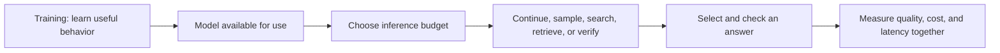

# Test-Time Compute — A Reading Guide

**An independent human and agent companion to [What is test-time compute and how to scale it?](https://huggingface.co/blog/Kseniase/testtimecompute).**

The source is a **Hugging Face Community Article**, published **6 February 2025**. Its closing byline credits **[Alyona Vert](https://huggingface.co/alyona0l), author**, and **[Ksenia Se](https://huggingface.co/Kseniase), editor**. It introduces a collection of research projects; it is not itself an experimental paper. Research credit belongs to the teams behind those projects. See the [research bibliography and author credits](references/README.md).

This repository, maintained by [0xHayd3n](https://github.com/0xHayd3n) with AI assistance, contains original explanations, reading questions, and a source-linked evidence ledger. It has no affiliation with the article's contributors, Hugging Face, or the research teams. **No research experiments, benchmark reproductions, or model implementations were performed here.** The source article, its images, and research PDFs are not redistributed.

## The idea in one minute

A model can spend its inference budget in different ways: continue one candidate, explore several candidates, score intermediate work, or retrieve information. A useful reading question is therefore **what extra operation is bought, and what makes its output trustworthy?** A longer answer alone does not establish better reasoning.

The article puts training recipes and inference procedures side by side. This guide separates the two: training may teach a useful behavior; a deployed procedure decides how often to invoke it. The final discussion of test-time training adds a third case, where adaptation can change weights during use. These are guide distinctions for reading the overview carefully, rather than a new taxonomy claimed by the article.



This is an original teaching diagram. It is not a recovered architecture for OpenAI o1 or a faithful implementation of every project discussed.

## Choose a reading route

| Goal | Read |
| --- | --- |
| Understand compute, reasoning, and the terminology | [1. Compute and reasoning](docs/01-compute-and-reasoning.md) |
| Separate learned capability from inference procedure | [2. Training and inference](docs/02-training-and-inference.md) |
| Compare multimodal search, verification, and retrieval | [3. Methods across modalities](docs/03-methods-across-modalities.md) |
| Audit reported numbers and strong claims | [4. Evidence and caveats](docs/04-evidence-and-caveats.md) |
| Navigate every section of the original article | [5. Source map](docs/05-source-map.md) |
| Practice the distinctions and plan an evaluation | [6. Exercises and evaluation](docs/06-exercises-and-evaluation.md) |
| Ask an AI agent to use this guide | [AGENTS.md](AGENTS.md), [LLMS.txt](LLMS.txt) |

**Quick route, about 15 minutes:** this page → modules 1 and 4 → the source conclusion. **Careful route, about an hour:** read the original article alongside modules 1–5, then work through module 6. Reading times are editorial estimates.

## What to take away

- Compare complete procedures, including candidate generation, judging, retrieval, and stopping rules.
- Keep training data size separate from the budget spent on a new request.
- Treat the article's numbers as historical, secondary reports. A harder subset, voting protocol, or unspecified improvement unit can change their meaning.
- Read language about human thinking and self-awareness as analogy or interpretation. It is not evidence of a mental state.
- Use the research references for deeper verification; this companion does not substitute for reading those papers.

The [evidence module](docs/04-evidence-and-caveats.md) retains important numerical reports and their caveats. [claims.json](metadata/claims.json) provides typed records, including unknown metric details rather than invented precision.

## Coverage and provenance

The complete article prose, all twelve linked sections, its resource list, and embedded figures were reviewed for this guide. Bibliographic pages were consulted to resolve author credits and research links; those checks are not full-text verification of the underlying experiments. The [source map](docs/05-source-map.md), [provenance record](metadata/source.json), and [verification notes](VERIFICATION.md) define the scope precisely.

The article is an unversioned webpage. This guide records its access date and an HTML snapshot hash, but does not claim to identify its original February 2025 bytes or every later edit. It preserves the article's historical frame rather than presenting a current leaderboard.

## Repository map

```text
README.md                 Overview and human reading routes
AGENTS.md / LLMS.txt       Grounding rules and agent navigation
docs/                     Six original reading modules
metadata/source.json      Source identity, coverage, and provenance
metadata/claims.json      Typed article claims and editorial cautions
metadata/references.json  Bibliography and credit records
references/               Human bibliography and article BibTeX
CITATION.cff              Preferred citation to the original article
ATTRIBUTION.md / LICENSE   Credit and license boundaries
CONTRIBUTING.md            Correction workflow
VERIFICATION.md            Validation scope and limitations
scripts/validate.py       Offline structure, links, and data checks
```

## Cite, reuse, and maintain

Cite **Vert (2025), edited by Se**, for the overview; cite the underlying teams when discussing their research. [CITATION.cff](CITATION.cff) and [BibTeX](references/article.bib) preserve the distinction between this guide and its source.

Original companion material is licensed under [CC BY 4.0](LICENSE). That license grants no rights to the original article, its embedded figures, the papers, models, datasets, or other third-party material. See [ATTRIBUTION.md](ATTRIBUTION.md).

Run the integrity checks with Python 3:

```sh
python scripts/validate.py
```

These checks establish document and data consistency, not experimental validity. Please submit corrections with a precise source location and separate new primary-paper evidence from what the article actually says. See [CONTRIBUTING.md](CONTRIBUTING.md).
